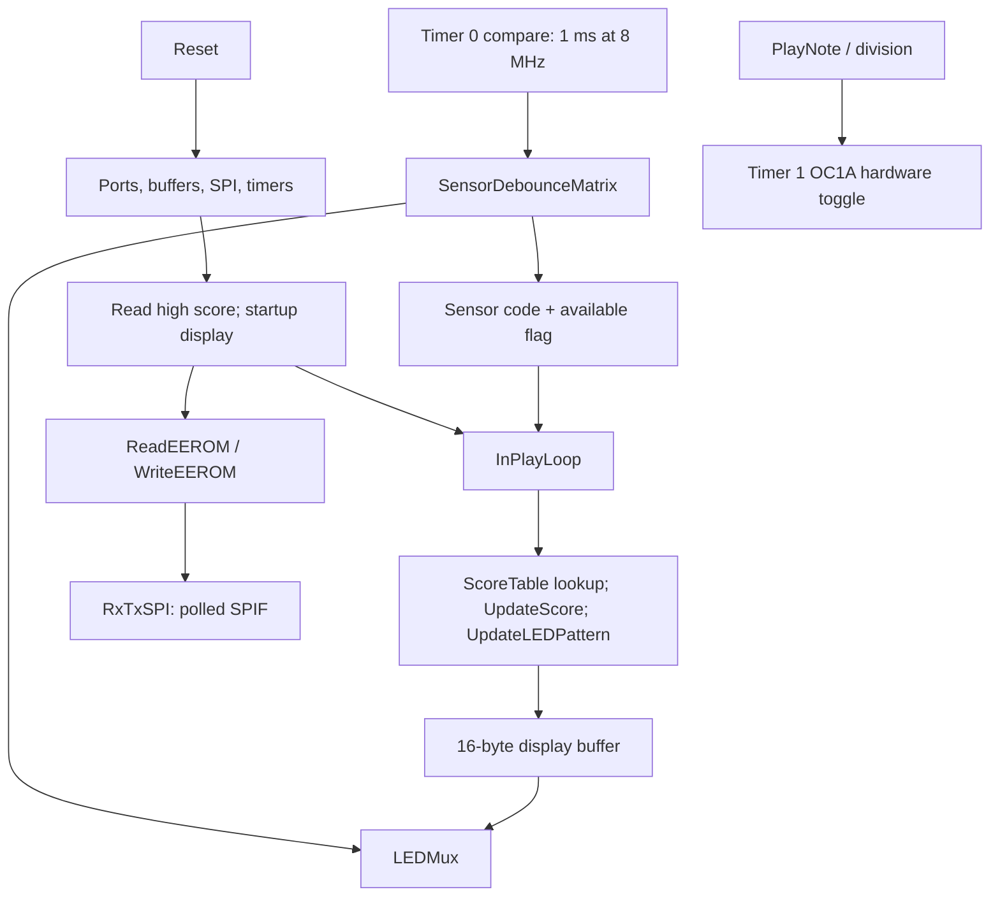

# Pinball controller — Caltech EE10B

AVR assembly for an ATmega64 replacement pinball controller. This archive preserves the supplied source, including incomplete integration paths; it is not a verified, flash-ready release.

## Hardware

The [schematic](docs/pinbsch.pdf) labels an ATmega64L with an 8 MHz crystal, a 5-row × 8-column switch matrix with 10 kΩ column pull-ups, two LTC3710 four-digit displays, an LE-MM103 LED matrix, ULN2003A driver arrays, a speaker, and a 93C46A serial EEPROM. It also includes reset, power, JTAG and a USB/PIC programming interface. The USB connector is not an AVR USB peripheral.


The source configures Port E as switch-column inputs and Port G as active-low row outputs. Port C carries multiplexed display data; Ports A and D select matrix rows/display digits. A 16-byte SRAM buffer allocates eight bytes to 64 lights and four bytes per player's hexadecimal score. PB5/OC1A drives the speaker. PB0 is EEPROM chip select, PB1 clock, PB2 data out and PB3 data in/ready. `DispenseBall` pulses PA7 with a busy-wait delay, but the supplied schematic does **not** establish a separate solenoid power stage; PA7 also participates in display multiplexing. Do not infer a safe solenoid connection from that helper alone.

## Source map

All assembly and includes are in `src/`; `Mainloop.asm` is the single translation unit and textually includes the modules (no linker).

| Files | Role |
| --- | --- |
| `Mainloop.asm` | Reset vector, interrupt vectors, state allocation and foreground scoring loop |
| `Init_Display.asm`, `display_routine.asm`, `DisplayCons.inc` | Port setup, buffer clearing, hexadecimal formatting, individual light updates, `LEDMux` |
| `Init_Sensor.asm`, `sensor_routine(with full comment).asm`, `SensorCons.inc` | Matrix setup, scanning/debounce and event mailbox |
| `sensor_routine.asm` | Alternate, non-identical sensor implementation; not included by the entry point |
| `InitTimer.asm` | Timer 0 compare ISR and Timer 1 hardware tone setup |
| `Helper.asm` | Attract display, start-button selection, score updates, moving light, ball dispense and high-score helpers |
| `sound.asm`, `util.asm` | Tone compare calculation and unsigned 24-by-16 division |
| `SPI.asm`, `EEROM.asm`, `SpeakerEEROMCons.inc` | Polled SPI, serial EEPROM byte-range interface, sound/storage constants |
| `SystemTables.asm` | Hex segment glyphs, column masks, digit selects and score/frequency pairs |

## Execution and timing

Reset sets the stack to `RAMEND`, initializes display and sensor ports/state, sound, SPI, Timer 0 and Timer 1, then reads two high-score bytes from EEPROM address zero. It writes an `8888` startup pattern and manually primes multiplexing before enabling interrupts, initializing player/score state and entering `InPlayLoop` (two players by default).

Only Timer 0 compare is routed to a real ISR. It saves registers/SREG, calls `SensorDebounceMatrix`, then `LEDMux`, restores context and returns with `RETI`. CTC uses prescaler 64 and OCR0 = 124: at the schematic's 8 MHz clock this is a 1 ms tick. One of 16 multiplex slots is advanced per tick, giving a nominal 62.5 Hz complete refresh. Scanning rotates through five active-low rows while idle and holds a row during debounce; a counter initialized to 10 checks stable input. The event code is `8 * rowcount + column` with one-based row/column counters; the foreground subtracts nine. Events occupy one shared code/available mailbox, not a queue. This is not a guarantee of independent per-switch debounce or one event per physical press.

Timer 1 uses CTC, prescaler 8 and hardware OC1A toggling, **not a sound ISR**. `PlayNote` computes OCR1A using the 500000 constant (8 MHz / 16) and a division helper. Its two input registers form the divisor; despite duration-oriented comments, there is no ISR duration countdown. The Timer 0 handler never calls a sound service.



## Game state and integration limits

The reachable foreground loop continually formats both 16-bit scores, consumes the sensor mailbox atomically, range-checks the mapped index, fetches the points word from a four-byte score/frequency entry, adds points, advances the light pattern and toggles the current player after each accepted event in two-player mode. It does not fetch or play the frequency word.

Other routines express a larger intended game: single/double start-button presses, attract-mode high-score display, ball counts, tilt tone, ball-out turn changes, dispense and end-game persistence. They are **not fully connected** in this snapshot: `MainLoop` and `StartPlaying` are referenced but not defined; the live scoring loop does not dispatch tilt/ball-out handlers or call the start selector. Ball counts are allocated but not initialized by Reset. These are source limitations, not implemented gameplay claims.

`CheckHighScore` reads two bytes, compares P1 first and P2 only if P1 is below the stored score, then writes a selected score. Consequently it does not necessarily choose the larger of both players' scores. Its end-game caller is not reached by the supplied live loop.

`EEROM.asm` adapts byte counts/addresses and an SRAM Y pointer to word-oriented serial operations. Odd boundaries use read-modify-write to preserve the other byte. `SPI.asm` enables AVR master SPI with SPR1/SPR0 set (clock /128), polls SPIF per byte and sends write-enable at initialization. EEPROM writes poll PB3 for readiness without a timeout. This is external 93C46A storage, not the MCU's internal EEPROM.

The sensor files are **not** merely comment variants. The fully commented file fixes the misspelled branch target (`InputChangeDuringDebounce` versus defined `InputChangedDuringDebounce`), bounds row-count rotation, retains pending availability during idle rotation, and omits duplicate mailbox allocations already in `Mainloop.asm`; it also uses different constant aliases. Both originals are retained unchanged, and the existing include selects the fully commented version.

## Build status

The syntax implies an Atmel-compatible AVR assembler and the ATmega64 device definitions `m64def.inc`. From `src/`, an attempted compatibility check was:

```sh
avra -I /usr/share/avra Mainloop.asm
```

The installed AVRA 1.3.0 rejected its bundled device include with `Error : Unknown device: ATmega64`. **Not successfully assembled here.** No binaries, flashing procedure, fuse settings or hardware tests are supplied. Even with a compatible assembler, the undefined game-loop labels above need resolution before claiming a working build. Source was preserved rather than repaired as part of this archive.
