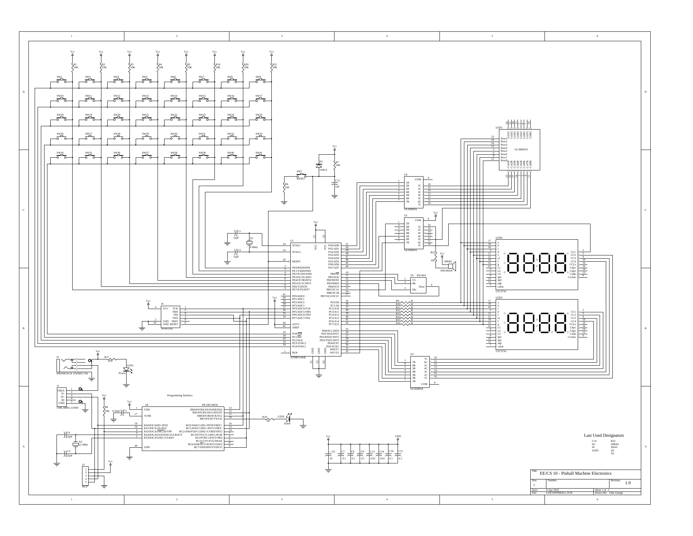
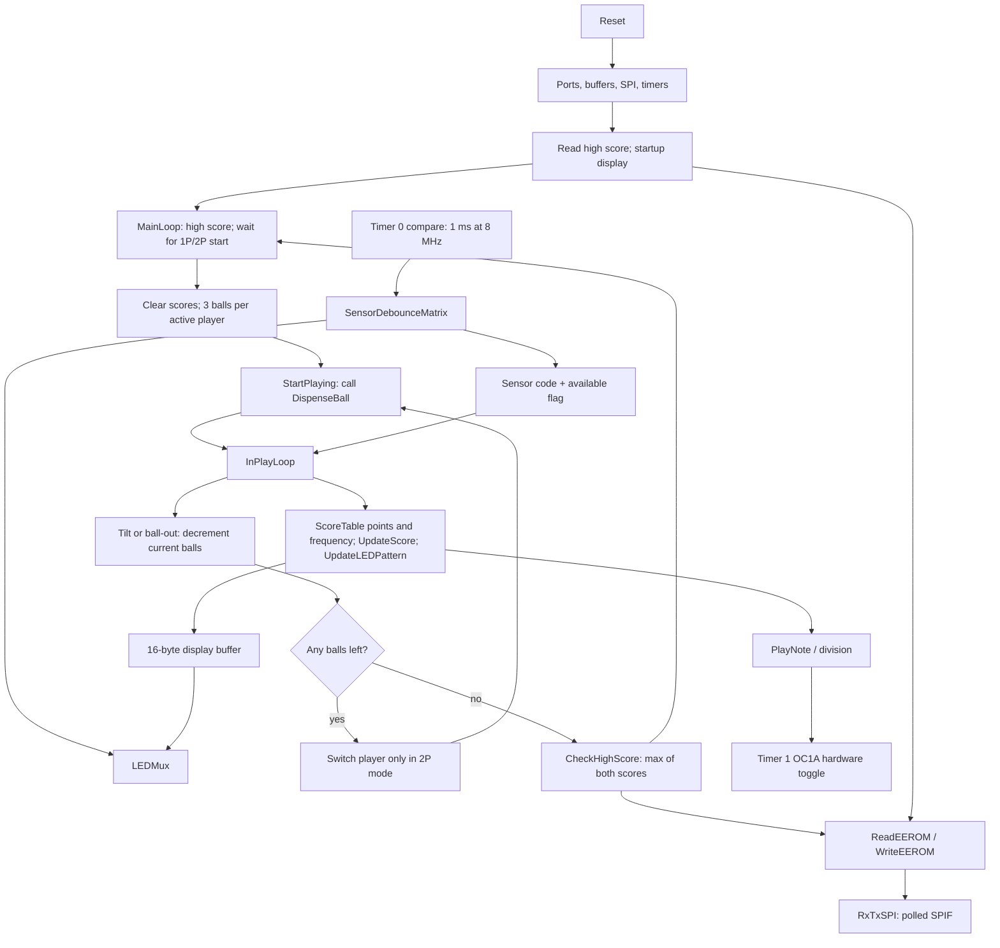

# Pinball controller — Caltech EE10B

AVR assembly for an ATmega64 replacement pinball controller. The foreground integrates attract mode, player selection, ball turns, scoring/tone feedback and high-score persistence. It assembles with AVRA; electrical operation and gameplay remain unverified on hardware.

## Hardware

The [schematic](docs/pinbsch.pdf) labels an ATmega64L with an 8 MHz crystal, a 5-row × 8-column switch matrix with 10 kΩ column pull-ups, two LTC3710 four-digit displays, an LE-MM103 LED matrix, ULN2003A driver arrays, a speaker, and a 93C46A serial EEPROM. It also includes reset, power, JTAG and a USB/PIC programming interface. The USB connector is not an AVR USB peripheral.



The source configures Port E as switch-column inputs and Port G as active-low row outputs. Port C carries multiplexed display data; Ports A and D select matrix rows/display digits. A 16-byte SRAM buffer allocates eight bytes to 64 lights and four bytes per player's hexadecimal score. PB5/OC1A drives the speaker. PB0 is EEPROM chip select, PB1 clock, PB2 data out and PB3 data in/ready. `DispenseBall` pulses PA7 with a busy-wait delay, but the supplied schematic does **not** establish a separate solenoid power stage; PA7 also participates in display multiplexing. Do not infer a safe solenoid connection from that helper alone.

## Source map

All assembly and includes are in `src/`; `Mainloop.asm` is the single translation unit and textually includes the modules (no linker).

| Files | Role |
| --- | --- |
| `Mainloop.asm` | Reset vector, interrupt vectors, state allocation and foreground scoring loop |
| `Init_Display.asm`, `display_routine.asm`, `DisplayCons.inc` | Port setup, buffer clearing, hexadecimal formatting, individual light updates, `LEDMux` |
| `Init_Sensor.asm`, `sensor_routine(with full comment).asm`, `SensorCons.inc` | Matrix setup, scanning/debounce and event mailbox |
| `sensor_routine.asm` | Alternate, non-identical sensor implementation; not included by the entry point |
| `InitTimer.asm` | Timer 0 compare ISR and Timer 1 hardware tone setup |
| `Helper.asm` | Attract display, start-button selection, score updates, moving light, ball dispense and high-score helpers |
| `sound.asm`, `util.asm` | Tone compare calculation and unsigned 24-by-16 division |
| `SPI.asm`, `EEROM.asm`, `SpeakerEEROMCons.inc` | Polled SPI, serial EEPROM byte-range interface, sound/storage constants |
| `m64def.inc` | Local ATmega64 register subset and AVRA core compatibility selection |
| `SystemTables.asm` | Hex segment glyphs, column masks, digit selects and score/frequency pairs |

## Execution and timing

Reset sets the stack to `RAMEND`, initializes display and sensor ports/state, sound, SPI, Timer 0 and Timer 1, then reads two high-score bytes from EEPROM address zero. It writes an `8888` startup pattern and manually primes multiplexing before initializing idle state, enabling interrupts and entering `MainLoop` attract mode.

Only Timer 0 compare is routed to a real ISR. It saves registers/SREG, calls `SensorDebounceMatrix`, then `LEDMux`, restores context and returns with `RETI`. CTC uses prescaler 64 and OCR0 = 124: at the schematic's 8 MHz clock this is a 1 ms tick. One of 16 multiplex slots is advanced per tick, giving a nominal 62.5 Hz complete refresh. Scanning rotates through five active-low rows while idle and holds a row during debounce; a counter initialized to 10 checks stable input. The event code is `8 * rowcount + column` with one-based row/column counters; the foreground subtracts nine. Events occupy one shared code/available mailbox, not a queue. A stable held switch is reported once until its input changes; column eight is scanned as well. Pending events are retained until consumed, but another press can overwrite the single mailbox. The scanner remains on a held row, so simultaneous switches on other rows are not independently monitored.

Timer 1 uses CTC, prescaler 8 and hardware OC1A toggling, **not a sound ISR**. `PlayNote` computes OCR1A using the 500000 constant (8 MHz / 16) and a division helper. Its two input registers carry a 16-bit frequency, not a frequency/duration pair. Zero disconnects OC1A and drives PB5 low; a subsequent nonzero note reconnects toggling. Notes persist until changed or silenced in attract mode; there is no duration countdown. The Timer 0 handler never calls a sound service.



## Game flow and sensor assignments

`MainLoop` silences the speaker, displays the stored high score through `ShowAttractMode`, and calls the blocking `WaitForStartButton` selector. A single press selects one player; a second press during its busy-wait window selects two. Both comparisons normalize the scanner's raw code by subtracting nine. The original delay loops are retained: the window is iteration-based, not a calibrated 500 ms timer.

A new game clears both 16-bit scores, current player (P1), light indices, mailbox and display buffer. `BALLS_PER_GAME = 3` in `SensorCons.inc` initializes P1 and, only in two-player mode, P2; inactive P2 has zero balls. `StartPlaying` calls the existing `DispenseBall` helper and enters `InPlayLoop`.

The foreground formats scores, consumes an event atomically and rejects codes outside the 40-entry matrix. Named event constants are **normalized zero-based indices**: start = 0 (row 1, column 1), tilt = 38 (row 5, column 7), ball-out = 39 (row 5, column 8). The original tilt/ball-out numeric constants were retained; their contradictory row/column comments were corrected to match the scanner's arithmetic. These switch functions are software assumptions: the schematic labels switches but does not identify physical tilt/drain assignments. Start presses during play do not score.

Other accepted events load both the points and frequency words from `ScoreTable`, update the active player's score, play its tone and advance the light pattern. Scoring **does not** switch players. Tilt plays a 100 Hz tone and follows the ball-out path, consuming the current ball. Ball-out decrements the current player's remaining count and toggles turns only in two-player mode, as the existing handler intended. With equal initial counts and alternating ball losses, neither player is selected after exhausting their final ball; after three losses per active player the game ends. The end-game path stores `max(P1, P2)` only when it is strictly greater than the stored high score, then returns to attract mode.

### Hardware limits still requiring verification

Calling the dispense helper is not proof that a ball can safely be launched. Its assumed PA7 solenoid output **conflicts with the multiplexed display select on the schematic**: `LEDMux` overwrites Port A every tick, including during the helper's delay. A verified, separate actuator driver/pin allocation is required before enabling a real coil. This change does not invent or rewire that hardware. Tilt also immediately ends a software ball; distinguishing a later physical drain from a new ball requires hardware/gameplay validation. Contact bounce, simultaneous sensors, coil timing, audio quality, external EEPROM protocol and blank-EEPROM initialization have not been validated on a board. An erased high score of 0xffff is not automatically reset.

`EEROM.asm` adapts byte counts/addresses and an SRAM Y pointer to word-oriented serial operations. Odd boundaries use read-modify-write to preserve the other byte. `SPI.asm` enables AVR master SPI with SPR1/SPR0 set (clock /128), polls SPIF per byte and sends write-enable at initialization. EEPROM writes poll PB3 for readiness without a timeout. This is external 93C46A storage, not the MCU's internal EEPROM.

The sensor files are **not** merely comment variants. The fully commented file fixes the misspelled branch target (`InputChangeDuringDebounce` versus defined `InputChangedDuringDebounce`), bounds row-count rotation, retains pending availability during idle rotation, and omits duplicate mailbox allocations already in `Mainloop.asm`; it also uses different constant aliases. The unused alternate is retained as an archival variant; only the fully commented implementation is included. The active version now also scans column eight and suppresses repeat events while a switch remains held.

## Build and software checks

From the repository root, with AVRA 1.3.0 installed:

```sh
mkdir -p build
avra -I src -o build/pinball.hex -l build/pinball.lst -m build/pinball.map src/Mainloop.asm
python -m unittest discover -s tests -v
```

The local `src/m64def.inc` provides only the ATmega64 registers/bits used here, with I/O offsets and extended data-space addresses matching the ATmega64 definitions. AVRA 1.3 does not list ATmega64, so `.device ATmega128` selects its compatible instruction core, 0x0100 SRAM origin, 4 KiB SRAM and interrupt-vector layout. **The hardware target remains ATmega64**, not ATmega128: RAMEND is 0x10ff and FLASHEND is 0x7fff words, with explicit final SRAM/flash bounds checks. No ATmega128-only peripheral definitions are used. This compatibility selection is not a fuse/programmer configuration.

Assembly produces Intel HEX, listing and symbol map under `build/` (ignored). The Python regression harness executes the foreground, sensor and sound/math source instructions with peripheral stubs and AVRA symbols. It checks player selection/initialization, scoring ownership and frequency lookup, all ball turns through attract return, tilt, invalid/empty input, held column-eight events, strict maximum high-score writes and sound compare/silence. It is **not** a cycle-accurate AVR or interrupt/electrical simulation. No flashing or hardware test is implied by clean assembly or these checks.
